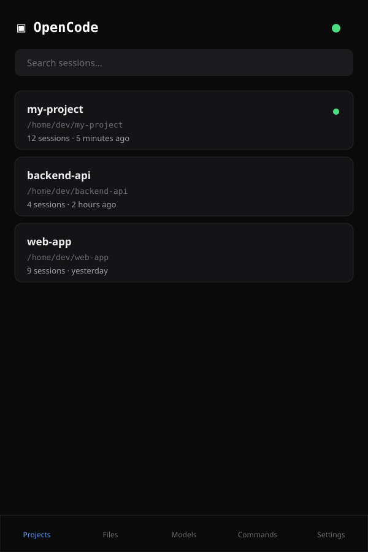
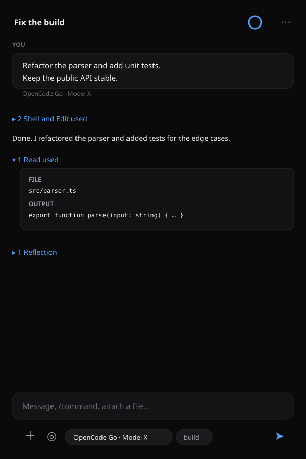
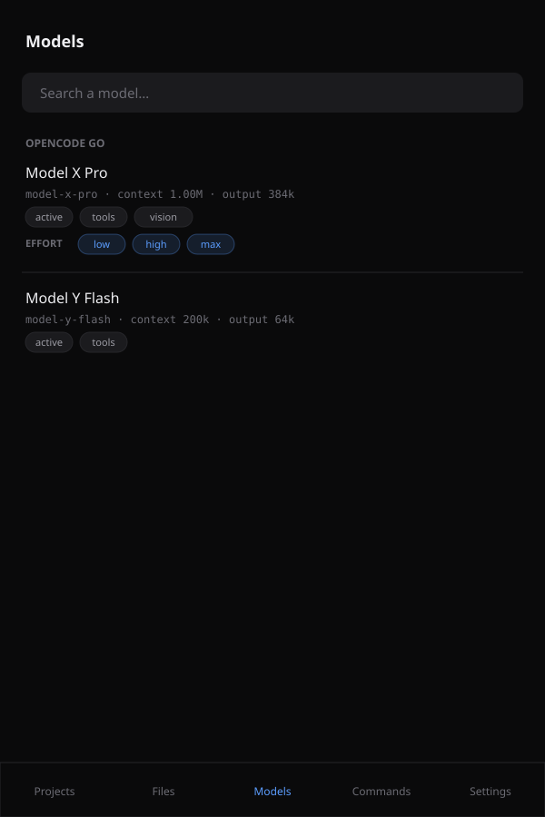

# OpenCode Remote

**Android remote control for OpenCode Desktop** — see and drive the same sessions from your phone,
over your LAN or a VPN (e.g. a Freebox VPN), with **real-time streaming** of reasoning, tools,
text, cost and tokens.

> OpenCode Desktop is a *frontend* of the shared OpenCode background service. OpenCode Remote
> connects to **that same service** (through a small companion bridge), so the phone and the
> Desktop see the exact same sessions. The bridge **never modifies OpenCode**.

```
Android app ──HTTP + WebSocket──► companion bridge (Node) ──localhost──► OpenCode service ◄── Desktop / TUI
```

<p align="center">
  
  
  
</p>

---

## Features

**Sessions**
- **Projects page → project sessions page**: browse projects (name + disk path, copyable, active first)
  then the sessions of a project (active first).
- Create a session in a project folder, rename, fork, delete, search.

**Conversation**
- Real-time streaming: **reasoning**, **tool calls**, text, status, cost and tokens.
- **Reasoning + tools are grouped** in one collapsible line ("2 Edit and Shell used"), each row
  showing a **mapped summary** (command, file path, URL) and its duration — never raw JSON.
- Long user prompts are **collapsed to ~6 lines** (tap to expand, copy button).
- Full **Markdown** + **syntax highlighting** (Shiki), **diffs** rendered per turn.
- **Composer**: attach files/camera, `/` **command autocomplete** as an overlay, **model** and
  **agent** selectors under the input.
- **Questions & permissions** fully supported (forms + permission requests) with **local notifications**.

**Context & models**
- **Circular context progress** (based on the last step) → tap for full details (provider, model,
  effort, agent, messages, tokens, cost, dates).
- **Model picker** with search, grouped by provider (OpenCode Go first), model × **effort**.
- Models page with context/output limits, cost, capabilities, family and **all effort variants**.
- **Commands** (all built-ins + server commands), **Skills** and **MCP** servers.

**Files**
- Project-scoped file browser with **image preview** and text/code viewer.
- Access is **restricted to OpenCode project roots** (enforced by the bridge, not just the UI).
- **File links inside messages are clickable** (paths / `file://` URLs) and open in the viewer.

**Remote execution**
- **Terminal console** (`/console`): run **shell commands remotely** in the project directory and
  see the output, exit code and duration (via `POST /api/shell` + output polling).
- In the composer, prefix a message with **`!command`** to run a one-shot shell command and see the
  result inline.
- Commands `/terminal`, `/pty`, `/shell` open the console; `/export` exports the session (share on
  Android, copy on web); `/open` opens Files; `/connect` opens Models; `/help` lists commands.

**Experience**
- **Dark + light**, OpenCode-like, **Tailwind CSS v4** + **Motion** animations.
- **Toast** notifications for every action, robust clipboard copy (works in the WebView).
- **Full i18n (French, English, Japanese)** — every user-facing string, plus localized dates/numbers.
- **First-launch onboarding** that requests permissions (notifications/camera).
- **Constant-height header** ("OpenCode" + section) and **Android back-gesture** support.
- **Prominent offline/unauthorized banner** everywhere, with a one-tap fix.
- **Default model** picked from your last used model / recent sessions (never left empty).
- **Draft persistence**: the composer text and attachments are saved per session, so a prompt
  survives an app crash or close and can be resumed.
- **Sub-agent sessions are hidden** from the project lists (they belong to a parent session).
- **Performance**: only the latest messages load (older ones paginate on scroll-up), memoized
  message rendering, abortable requests, chunked diff rendering.

**Android & iOS**
- **Android**: local notifications (questions, permissions, **"session finished"**), a **responsive
  home-screen widget** (and **lock-screen** where supported) that adapts to its size — one session
  with a live timer when compact, a **list of running sessions** when there is room — permissions
  management in Settings, notification icon, and an OpenCode launcher icon.
- **iOS** (prepared, see [docs/ios.md](docs/ios.md)): Capacitor platform + **WidgetKit** widget
  (small/medium/large) + iOS plugin writing to a shared App Group.
- **QR pairing**: the bridge prints an **ASCII QR** and writes `~/.opencode-remote/qr.png`; the app
  can **scan a QR** from the camera (Settings → "Scan a QR") or open the pairing deep link
  `ai.opencode.remote://connect?host=…&port=…&token=…`.

**Windows tray**
- `tray\start-tray.cmd` shows a **system-tray icon** with a panel to view the **QR code**, copy the
  pairing link, and start/stop the bridge (reads `~/.opencode-remote/state.json`).

**Preview**
- **In-app preview** of what OpenCode produced: the bridge probes common dev-server ports
  (`/servers`) and the app shows the site/dev server in an embedded browser — pick a detected
  port or type one. Gated by an explicit **permission** prompt the first time.

**Security**
- Keep the bridge inside your **VPN** (WireGuard/OpenVPN) when you are away.
- On **local Wi-Fi** the traffic is not encrypted by the tunnel, so the bridge supports **TLS**:
  `--tls` (auto self-signed certificate, fingerprint printed) or `--tls --cert <pem> --key <pem>`.
  Enable "Encrypted connection (HTTPS/WSS)" in Settings. The Android app trusts self-signed certs
  for private/LAN hosts only, and also trusts user-installed CAs (e.g. mkcert) for full trust.
- Bearer token auth; filesystem access restricted to project roots; **no secrets committed**.

---

## Quick start

### 1. Requirements
- **OpenCode Desktop** (or TUI/CLI) launched at least once, so the shared service is running.
- **Node.js ≥ 20** on the machine running OpenCode.
- For the APK: **Android Studio** (or Android SDK + JDK 21).

### 2. Clone & install
```bash
git clone https://github.com/sebastienaglae/opencode-app
cd opencode-app
npm install
cd bridge && npm install && cd ..
```

### 3. Detect OpenCode (does not modify it)
```bash
npm run detect
```
Reads `service.json` (and the `opencode` binary on PATH) and prints the URL/version. If nothing is
found, launch OpenCode Desktop once and re-run.

### 4. Start the bridge
```bash
npm run bridge        # or: ./start-bridge.ps1  /  ./start-bridge.sh
```
It prints the host, the port and a **Bearer token**:

```
OpenCode service : http://127.0.0.1:49374  (v2.x)
Bridge listening : 0.0.0.0:47821
Auth             : Bearer <token>
Path scope       : 12 project root(s)
```

### 5. Run the app
```bash
npm run dev           # browser: http://localhost:5173
# or build the Android app:
npm run build && npx cap sync android && npx cap open android
```

In **Settings**, enter the host (LAN/VPN IP), the port, and the token, then **Save & connect**.
The app probes the primary port and falls back to the candidate ports automatically.

---

## Companion bridge

The bridge (`bridge/`) is a small Node/TypeScript server. It:
- reads `~/.local/state/opencode/service.json` (`%USERPROFILE%\.local\state\...` or `$XDG_STATE_HOME`),
- proxies the OpenCode HTTP API at the same paths (`/api/*`),
- streams OpenCode events over **WebSocket** at `/events`,
- requires `Authorization: Bearer <token>` (except `/health`),
- **scopes `/api/fs/*` to OpenCode project roots**,
- binds `0.0.0.0` on the first free port of a fixed obscure list.

| Flag | Effect |
|------|--------|
| `--server <url>` / `--password <secret>` | Explicit OpenCode service (skip `service.json`) |
| `--service-file <path>` | Explicit `service.json` |
| `--token <token>` | Fixed bearer token (else generated & persisted in `~/.opencode-remote/config.json`) |
| `--host <addr>` / `--ports a,b,c` | Bind address / candidate ports |
| `--anonymous` | Disable auth (dev only) |
| `--allow-any-path` | Disable filesystem scoping (unsafe) |
| `--tls` | Serve HTTPS/WSS (auto self-signed cert, or `--cert`/`--key`) |
| `--cert <pem>` / `--key <pem>` | TLS certificate / key (optional) |

The OpenCode service stays on **localhost**; only the bridge is exposed to the VPN.

---

## Android

```bash
npm run build
npx cap sync android
npx cap open android          # then Run in Android Studio
# or
npm run android:debug         # -> android/app/build/outputs/apk/debug/app-debug.apk
```

Configured in the native project:
- `INTERNET` + `POST_NOTIFICATIONS` permissions, `usesCleartextTraffic="true"`.
- **Notification permission** is requested at runtime (Android 13+).
- **Home-screen widget** (`SessionWidgetProvider`) updated from the app state.
- Launcher icon generated from the OpenCode mark (`npm run icons`).

---

## Tests

```bash
npm run test          # app unit tests + bridge tests
npm run test:app      # format + tools mapping (node --test)
npm run test:bridge   # SSE parser, config, server auth/path scoping
npm run lint
```

---

## Internationalization

All strings live in `src/core/i18n.ts` (**fr**, **en**, **ja**). Dates/numbers use `Intl` via
`src/core/format.ts`. To add a language: add a dictionary in `i18n.ts`, extend `LANGUAGES`,
and add a `values-<lang>/strings.xml` for the Android widget.

---

## Security

- Traffic stays inside your VPN; nothing is exposed to the Internet.
- The OpenCode service listens on localhost only; the bridge is the only exposed surface.
- Bearer token auth; filesystem access restricted to project roots.
- No secrets, tokens, IPs or personal paths are committed (docs use generic data).

---

## Troubleshooting

| Symptom | Fix |
|---------|-----|
| `No OpenCode service found` | Launch OpenCode Desktop once, or pass `--server` / `--password`. |
| App stays offline | Check host/port/token; test `curl http://<ip>:47821/health`. |
| `401` on `/api/*` | Wrong token (Settings). |
| `403` on files | Path outside project roots (by design); use the project picker. |
| No APK | Install JDK 21 + Android SDK, or build via Android Studio. |

---

## Layout

```
opencode-app/
├─ bridge/                 # companion bridge (Node/TS, no build step)
│  ├─ src/{index,config,opencode,server,sse}.ts
│  └─ test/
├─ src/                    # Ionic React + Vite + Tailwind v4 + Motion
│  ├─ core/                # api, stores, events, i18n, format, tools, clipboard, widget
│  ├─ components/          # MessageView, parts, Composer, ModelPicker, Toaster, Sheet…
│  ├─ screens/             # Projects, ProjectSessions, Conversation, Files, Models, Commands, Settings
│  └─ theme/               # ionic.css (layered) + theme.css (Tailwind tokens)
├─ android/                # Capacitor project (+ widget, notifications)
├─ scripts/                # icons, OpenCode detection
├─ docs/screenshots/       # sanitized mockups
├─ AGENTS.md               # AI/agent setup guide
└─ PLAN.md                 # architecture + API/event mapping
```
